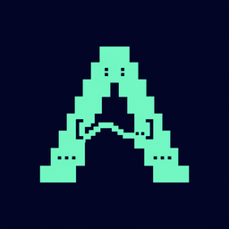
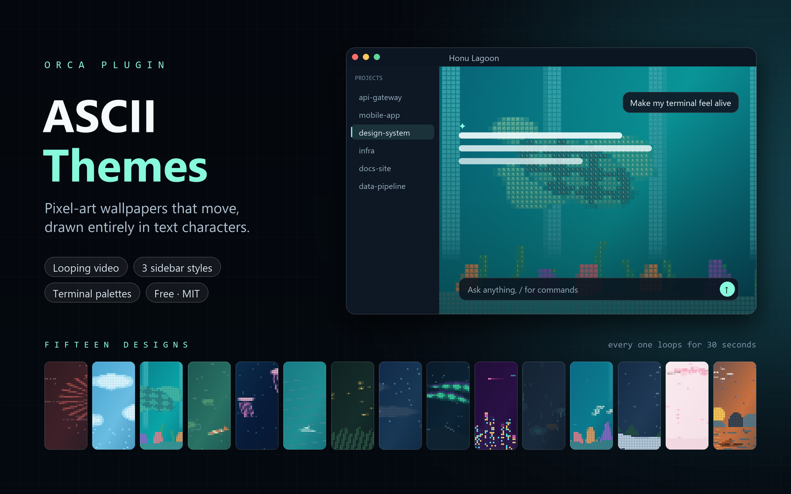

  

<h1 align="center">ASCII Themes for Orca</h1>

A little motion. A lot of characters.

  15 animated designs · 45 app themes · 15 terminal palettes · File and folder icons

Bring your Orca workspace to life with wallpapers drawn in ASCII characters. Watch koi drift through a pond, northern lights move across the sky, or the Vietnamese flag wave over Ha Long Bay, with matching app and terminal colors, plus an ASCII file icon theme.

Every design includes a 30-second video loop and a still-image fallback. Choose matching sidebars or keep a familiar dark or light sidebar alongside your wallpaper.

**Find it useful?** Please consider [giving this project a GitHub star](https://github.com/dohaidang/orca-theme-plugin). It helps other Orca users discover the themes and supports the project. Thank you!

## What's included

- **15 wallpaper designs:** 14 dark designs and one light design, Cherry Blossom.
- **45 app themes:** three sidebar variants for every design.
- **15 terminal palettes:** a matching color palette for each scene.
- **ASCII · Icons:** a file and folder icon theme to complete the workspace.
- **Still-image fallbacks:** wallpapers remain available when video playback is unsupported or reduced motion is enabled.

The plugin is content only: it provides themes, images, videos, and icons. It runs no plugin code.

## Get started

### Requirements

| Orca version | Wallpaper support |
| --- | --- |
| 1.4.246–1.4.253 | Still wallpapers |
| 1.4.254 or newer | Animated wallpapers and still-image fallbacks |

### Install and choose a theme

1. Open **Settings → Plugins** in Orca and choose **Add plugin → From a Git URL…**.
2. Enter `https://github.com/dohaidang/orca-theme-plugin` in **Repository URL**. Install and enable the plugin.
3. Open **Settings → Appearance → Interface** and select an `ASCII · …` design under **Dark theme** or **Light theme**. You can also use **Use now** on the plugin page.
4. Select **ASCII · Icons** under **Icon theme** in the same section if you want the matching file and folder icons.
5. Under **Settings → Appearance → Terminal → Terminal Themes**, choose the corresponding palette to match your terminal colors to the wallpaper.

### Make the wallpaper visible

Wallpapers appear behind translucent terminal and chat backgrounds. Set these options first:

1. Open **Settings**, search for **Background Opacity**, and set it below `1`. Try `0.4` as a starting point, then adjust for comfortable reading.
2. Search for **Reduce Visual Effects** and turn it off. You can also find it under **Appearance → Interface → Advanced**.
3. Return to your workspace and keep the Orca window focused to see the animation.

Video playback pauses when Orca loses focus or a modal overlay is open. Your system's reduced-motion setting uses the still wallpaper instead.

## Explore the collection

Theme names in Orca begin with `ASCII ·`.

| Design | Scene |
| --- | --- |
| **Coral Sunburst** | A coral sun with lines of code scrolling past |
| **Cloud Drift** | White clouds moving through a blue sky |
| **Honu Lagoon** | Sea turtles over sand, coral, and swaying seaweed |
| **Koi Pond** | Koi, lotus flowers, lily pads, and spreading ripples |
| **Jellyfish** | Pulsing jellyfish rising with trailing tentacles |
| **Paper Boats** | Paper boats sailing across rolling waves |
| **Fireflies** | Fireflies drifting above tall grass |
| **Moonlit** | A crescent moon, moving clouds, stars, and shooting stars |
| **Aurora** | Northern lights over a mountain ridge |
| **Neon City** | A skyline with flickering windows and flying cars |
| **Rainy Window** | Rain streaks and droplets over blurred city lights |
| **Coral Reef** | Schools of fish, swaying coral, and rising bubbles |
| **Snowfall Cabin** | Falling snow and a cabin with a smoking chimney |
| **Cherry Blossom** | Petals drifting from a blossoming branch; the light design |
| **Việt Nam** | The national flag waving at dawn over Ha Long Bay, with boats and birds |

## Choose your sidebar style

Each design has three variants. The wallpaper stays the same; choose how you want the project and file sidebars to look.

| Variant | Sidebar appearance |
| --- | --- |
| `ASCII · <name>` | Colors coordinated with the wallpaper |
| `ASCII · <name> (dark sidebar)` | Orca's built-in dark sidebar colors |
| `ASCII · <name> (light sidebar)` | Orca's built-in light sidebar colors |

App themes, terminal palettes, and file icons can be selected independently.

## Troubleshooting

### The wallpaper is missing

Check that an `ASCII · …` app theme is selected, **Background Opacity** is below `1`, and **Reduce Visual Effects** is off. Your system's reduced-transparency setting can also prevent the wallpaper from appearing.

### The wallpaper appears, but it does not move

- Use **Orca 1.4.254 or newer** for video playback.
- Focus the Orca window and return to the workspace from settings or modal dialogs.
- Check whether your system has reduced motion enabled; that setting intentionally keeps the still wallpaper.
- If animation stopped after updating the plugin, use **View → Force Reload**. On Windows, the shortcut is **Ctrl + Shift + R**. This reloads the interface and can clear an earlier video playback failure.

### The wallpaper makes text difficult to read

Increase **Background Opacity** until text is comfortable to read, and try a dark or light sidebar variant. Keep opacity below `1` to retain the wallpaper.

## Package contents

| Folder | Contents |
| --- | --- |
| `themes/` | 45 app theme definitions |
| `terminal/` | 15 terminal color palettes |
| `icons/` | The ASCII file and folder icon theme |
| `images/` | Wallpaper stills, video loops, the plugin icon, and cover image |

Wallpaper stills are **1920 × 1080 PNGs**. Videos are **960 × 540 H.264 MP4**, **20 fps**, **30 seconds**, with no audio. Each video is approximately **2.5–2.8 MB**.

## Feedback and contributions

Found a problem or have an idea for a new scene? [Open an issue](https://github.com/dohaidang/orca-theme-plugin/issues). For display or playback issues, include your Orca version, the theme name, and a screenshot if possible.

Pull requests are welcome. Please keep changes focused and describe what they improve.

## License

[MIT](LICENSE)
